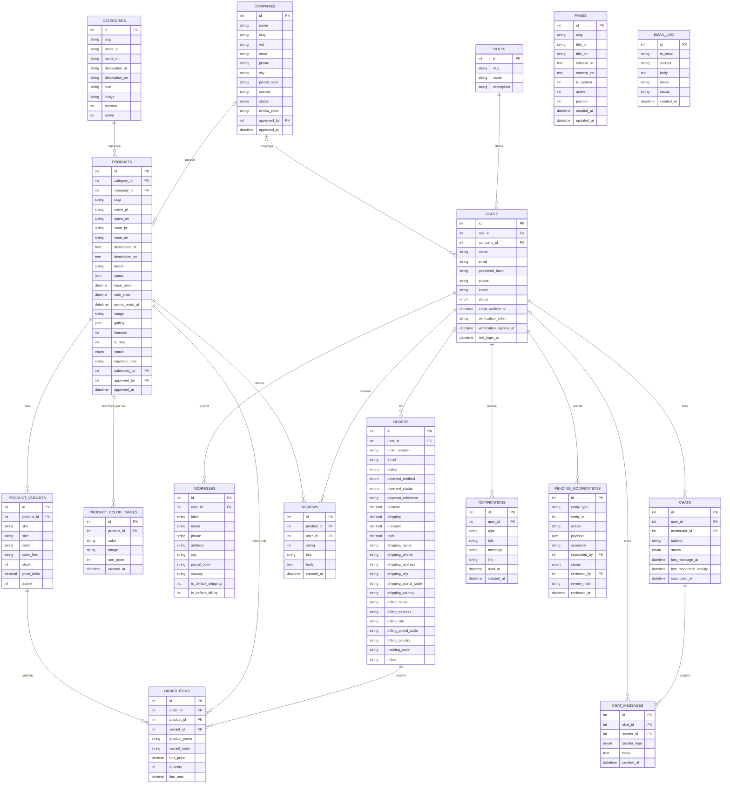
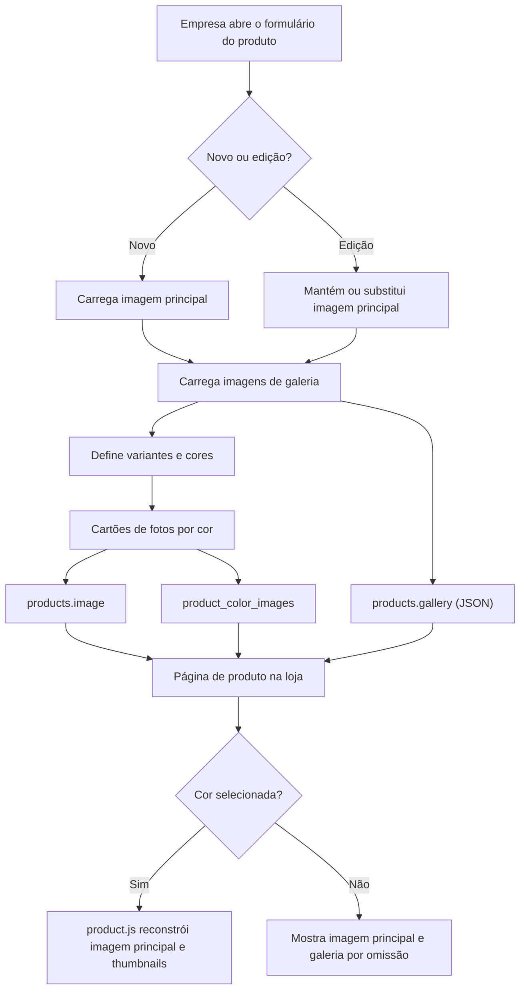
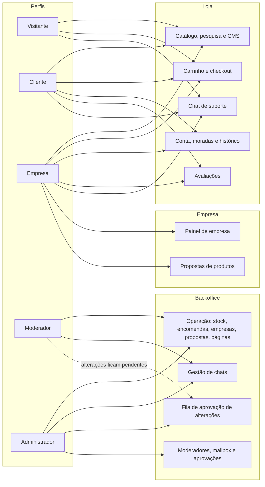
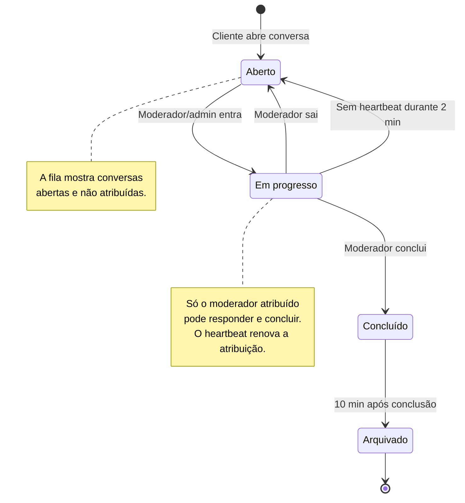
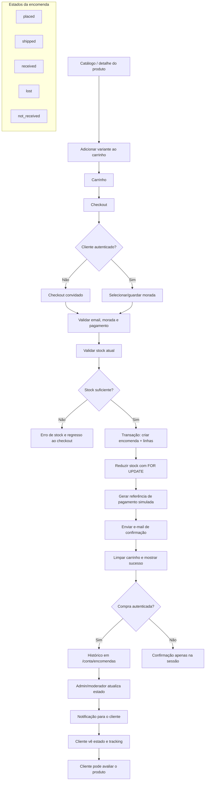
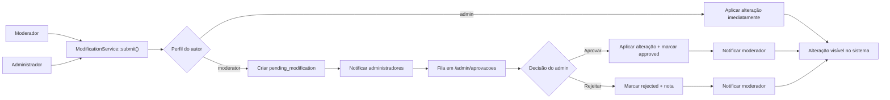
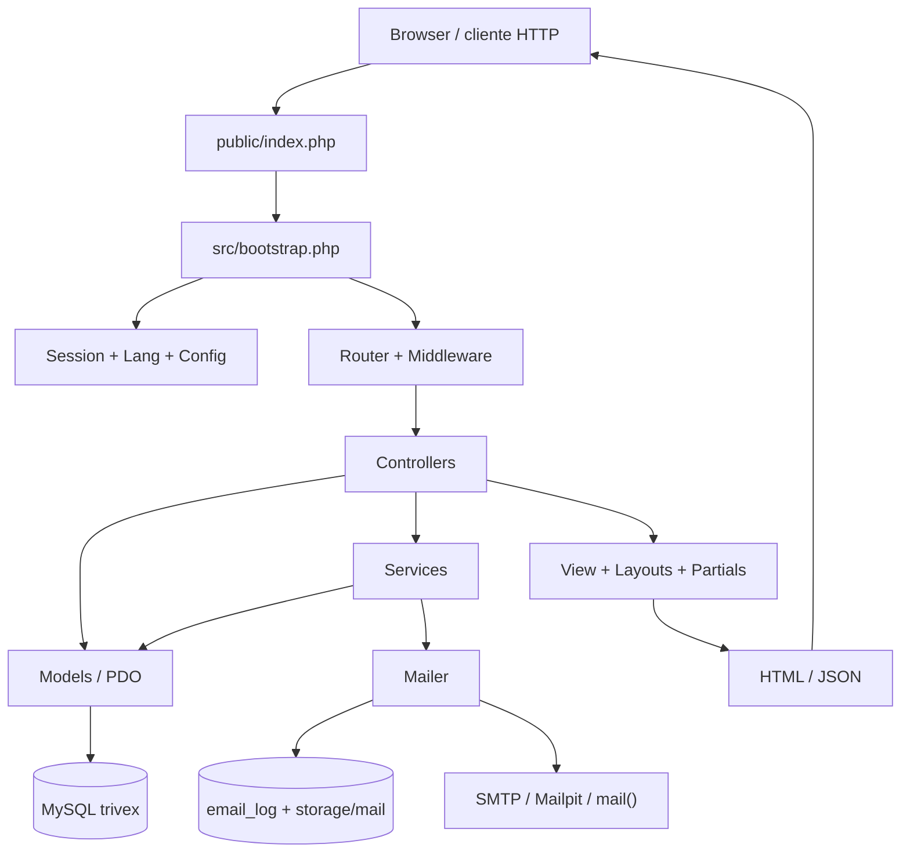

# TRIVEX — Diagramas

Documento de apoio à arquitetura e às regras de negócio. Os diagramas usam **Mermaid**, suportado nativamente pelo GitHub, GitLab, VS Code e pela maioria dos editores Markdown.

---

## 1. ERD — Modelo de dados

O schema usa 17 tabelas e chaves estrangeiras com integridade referencial. `orders.user_id` é opcional para permitir checkout de convidados. `order_items` guarda uma cópia do nome e do preço no momento da compra, para preservar o histórico mesmo que o produto mude. `product_color_images` guarda as fotografias específicas de cada cor, mantendo `products.image` como imagem principal e `products.gallery` como galeria JSON.

### Notas do modelo

- `COMPANIES.approved_by` aponta para `USERS`; o respetivo utilizador é normalmente um administrador.
- `PRODUCTS.submitted_by` e `PRODUCTS.approved_by` também referenciam `USERS`; são FKs históricas e não alteram o proprietário da empresa.
- `PENDING_MODIFICATIONS.requested_by` e `reviewed_by` referenciam `USERS`; a tabela funciona como fila de aprovação para alterações de moderadores.
- `CHAT_MESSAGES.sender_type` distingue `user`, `moderator` e `system`; mensagens de sistema têm `sender_id` nulo.
- `ORDERS` pode ter `user_id` nulo (convidado). O acesso à confirmação é validado por sessão ou pelo proprietário autenticado.
- `ORDER_ITEMS.product_name` e `unit_price` são snapshots históricos. Se um produto for removido, a encomenda mantém a informação.
- `PRODUCT_COLOR_IMAGES.color` usa o mesmo texto exato da cor em `PRODUCT_VARIANTS.color`; a loja agrupa as imagens por essa chave.
- `PRODUCTS.image` é a imagem principal; `PRODUCTS.gallery` é um array JSON de imagens adicionais; `PRODUCT_COLOR_IMAGES` contém as fotos específicas de cada cor.
- `EMAIL_LOG` é a fonte da mailbox do backoffice quando o driver é `log`.

### 1.1 Fluxo de imagens do produto

---

## 2. Matriz de permissões

### 2.1 Visão visual

### 2.2 Tabela detalhada

| Capacidade / área | Visitante | Cliente | Empresa | Moderador | Administrador |
|---|---:|---:|---:|---:|---:|
| Ver homepage, catálogo, categorias, pesquisa, promoções e páginas CMS | Sim | Sim | Sim | Sim | Sim |
| Pesquisa instantânea e sugestões JSON | Sim | Sim | Sim | Sim | Sim |
| Carrinho e checkout | Sim (convidado) | Sim | Sim | Sim | Sim |
| Moradas guardadas, perfil e histórico | Não | Sim | Sim | Sim | Sim |
| Criar/editar avaliação | Não | Sim | Sim | Sim | Sim |
| Abrir chat de suporte | Não | Sim | Sim | Sim | Sim |
| Responder no chat de cliente | Não | Sim | Sim | Sim | Sim |
| Backoffice de chats (entrar, sair, concluir) | Não | Não | Não | Sim | Sim |
| Painel de empresa | Não | Não | Sim, após aprovação | Não | Não |
| Submeter produto/proposta | Não | Não | Sim, após aprovação | Não | Não |
| Ver/editar stock, encomendas, utilizadores, empresas, propostas e páginas | Não | Não | Não | Sim, com aprovação | Sim, imediato |
| Alterar o próprio estado ou o de outro admin | Não | Não | Não | Não | Não aplicável |
| CRUD de moderadores | Não | Não | Não | Não | Sim |
| Fila de aprovações | Não | Não | Não | Não | Sim |
| Mailbox | Não | Não | Não | Não | Sim |
| Notificações de backoffice | Não | Não | Não | Sim | Sim |

### 2.3 Regras de aprovação

| Alteração | Admin | Moderador |
|---|---|---|
| Stock de variante | Aplica de imediato | Fica pendente |
| Estado de encomenda | Aplica de imediato | Fica pendente |
| Estado de utilizador | Aplica de imediato | Fica pendente |
| Estado de empresa | Aplica de imediato e ativa/reverte o proprietário | Fica pendente |
| Estado de produto/proposta | Aplica de imediato e notifica a empresa | Fica pendente |
| Ativação de página CMS | Aplica de imediato; homepage bloqueada | Fica pendente; homepage bloqueada |
| Mensagens/chat | Sem aprovação | Sem aprovação |
| Gestão de moderadores | Exclusivo do admin | Sem acesso |
| Mailbox | Exclusivo do admin | Sem acesso |

### 2.4 Middlewares

| Middleware | Efeito |
|---|---|
| `auth` | Exige sessão ativa; guarda `intended_url` e redireciona para `/login` |
| `guest` | Impede acesso a login/registo quando já existe sessão |
| `role:admin,moderator` | Exige um dos perfis indicados; caso contrário, 403 |
| `company` | Exige perfil empresa e empresa com estado `approved` |
| `throttle:key,limite,janela` | Limita tentativas por sessão (login, registo, checkout, newsletter) |

---

## 3. Fluxo de estados do chat

Estados em base de dados: `open`, `in_progress`, `concluded`, `archived`.
Rótulos na interface: **Aberto**, **Em progresso**, **Concluído**, **Arquivado**.

### Regras operacionais

1. `Chat::start()` cria a conversa em `open`, guarda a primeira mensagem e notifica a equipa.
2. `join()` faz `UPDATE ... WHERE status = 'open'` com verificação de concorrência; só um moderador consegue atribuir a conversa.
3. Enquanto está `in_progress`, o moderador envia heartbeat; o cliente pode continuar a responder.
4. `leave()` devolve a conversa a `open`, limpa `moderator_id` e regista uma mensagem de sistema.
5. `sweep()` devolve a `open` conversas sem heartbeat durante **2 minutos**.
6. `conclude()` passa a `concluded`, grava `concluded_at` e adiciona mensagem de sistema.
7. `sweep()` arquiva conversas concluídas há **10 minutos**.
8. O arquivo continua consultável em **Admin → Chats → Arquivo**.
9. O cliente só vê as suas conversas; a equipa vê a fila global.

---

## 4. Fluxo de compra e histórico

### Regras de compra

- O checkout está disponível para convidados e autenticados; o `user_id` fica nulo em compras de convidado.
- A criação da encomenda e a redução de stock ocorrem na mesma transação.
- O stock é validado novamente no servidor com `FOR UPDATE`, mesmo que o carrinho já tenha sido validado antes.
- Cartão e MB WAY são marcados como `paid`; Multibanco fica `pending` e recebe uma referência.
- O e-mail de confirmação é registado ou enviado; uma falha de e-mail não deve impedir a encomenda de existir.
- A página de sucesso é acessível por sessão (`last_order_number`) ou pelo proprietário autenticado.
- O histórico de cliente usa `/conta/encomendas` e `/conta/encomendas/{id}`.
- A equipa altera o estado em `/admin/encomendas/{id}/estado`; alterações de moderador passam pela fila de aprovação.
- Cada alteração de estado gera uma notificação para o cliente, quando existe conta associada.

---

## 5. Fluxo de aprovação de alterações

**Exceção:** o chat não passa por `ModificationService`. As ações de entrar, responder, sair e concluir são executadas diretamente pela equipa.

---

## 6. Arquitetura de runtime

### Camadas

| Camada | Responsabilidade |
|---|---|
| `public/index.php` | Controlador frontal, cabeçalhos de segurança, tratamento global de erros |
| `src/bootstrap.php` | Autoloader, `.env`, configuração, sessão, locale, timezone |
| `src/Core/Router.php` | Correspondência de rotas, parâmetros `{id}`, middleware |
| `src/Core/Middleware.php` | Autenticação, perfis, empresa aprovada e throttling |
| `src/Controllers` | Orquestração de pedidos, validação e respostas |
| `src/Models` | Acesso a dados com PDO e prepared statements |
| `src/Support` | Serviços transversais (`ModificationService`, `MailService`, auxiliares) |
| `src/Views` | Templates PHP, layouts e partials |
| `lang` | Dicionários PT/EN |
| `public/assets` | CSS, JavaScript e SVGs locais |

---

## 7. Legenda de estados

| Entidade | Estados |
|---|---|
| Encomenda | `placed`, `shipped`, `received`, `lost`, `not_received` |
| Pagamento | `pending`, `paid`, `refunded` |
| Empresa | `pending`, `approved`, `rejected` |
| Produto | `active`, `pending`, `rejected` |
| Utilizador | `pending`, `active`, `suspended` |
| Chat | `open`, `in_progress`, `concluded`, `archived` |
| Moderação | `pending`, `approved`, `rejected` |

---

## 8. Como visualizar

- **GitHub/GitLab**: o ficheiro é renderizado automaticamente na aba de código.
- **VS Code**: instala a extensão *Markdown Preview Mermaid Support* e abre o preview.
- **Mermaid Live Editor**: cola cada bloco em <https://mermaid.live> para exportar SVG/PNG.

> Os diagramas são documentação. A fonte de verdade continua a ser o código em `src/` e o schema em `database/database.sql`.
